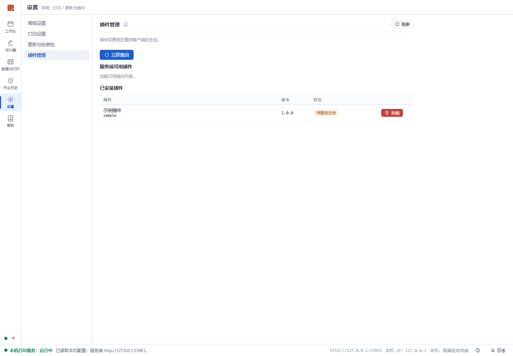
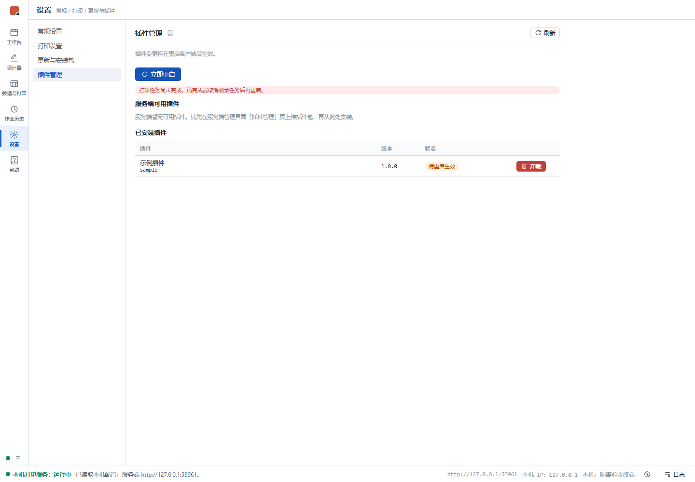
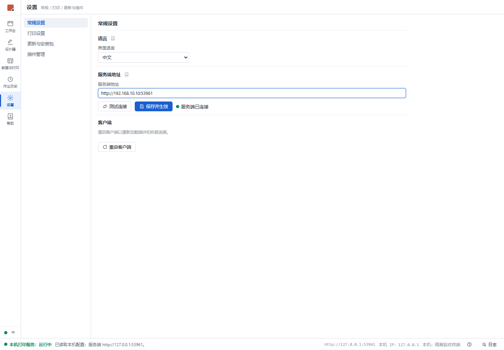

# 客户端安全重启验收证据

日期：2026-10-24。任务：[迭代 164 #451](https://github.com/marci-labs/LabelFrame/issues/451)。

## 已验证

- Windows 本地 `dotnet build LabelFrame.slnx`：0 警告、0 错误。
- `dotnet test LabelFrame.slnx --no-build --filter 'Category!=Perf&Category!=Soak'`：1,243 项通过。
- Node 26.12.1 / pnpm 12.15.0：client 与 server 模式各 761 项测试通过，双构建通过；lint 0 错误、51 条既有警告。
- 实际 Edge 浏览器（独立端口 5194，构建产物，API 使用隔离夹具）：插件提示刷新后持续存在；任务未完成返回原因并允许重试；常规设置入口；地址编辑 dirty 上报及恢复；页面收到维护令牌后 inert 并确认，取消后解除。无页面运行异常。此项验证界面行为，不替代真实插件加载或真实重启。
- Windows 等待器进程验证：临时独立探针通过反射调用当前程序集的 `RestartProcess.PrepareAsync` / `RunWaiterAsync`；等待器确认就绪后父进程退出，子进程实测父 PID 已不存在；父子用户一致，带空格参数完整，隐藏启动参数保留。该探针不运行打印宿主，不接触已安装客户端。
- 自动回归覆盖：整个 Pending/Printing/Suspended 批次拒绝；界面未保存/忙态/写操作/待回报结果拒绝；准备后新提交与写 API 拒绝；迟到 dirty 不覆盖关闭报告；等待全部界面冻结确认及最终 dirty 复查；等待器准备失败撤销门闩；重复重启只启动一次；本地提交失败且回报断网时保留维护保护，恢复连接并成功回报后解除。

## 界面记录

## 待验收

2026-10-24 追加：已在隔离 Windows 中完成完整客户端进程重启、未保存活动拒绝、标准用户真实 TSPL 插件安装后重启并 loaded=true / loadError=null；见 [复验记录](../165/windows-vm.md)。真实托盘菜单及完整界面路径仍待验收。

完整应用的 WebView2/托盘重启、固定插件页返回及真实插件重新加载须在隔离 Windows 环境串行复验。当前会话无法管理 Hyper-V 验收虚拟机（权限不足），已安装客户端保持运行。恢复条件：有权启动隔离虚拟机或提供独立 Windows 测试终端；安装候选客户端、准备测试插件，逐项验证三个入口、隐藏窗口恢复、打印批次/未保存内容拦截和新进程 loaded/loadError。未推发版 tag。
