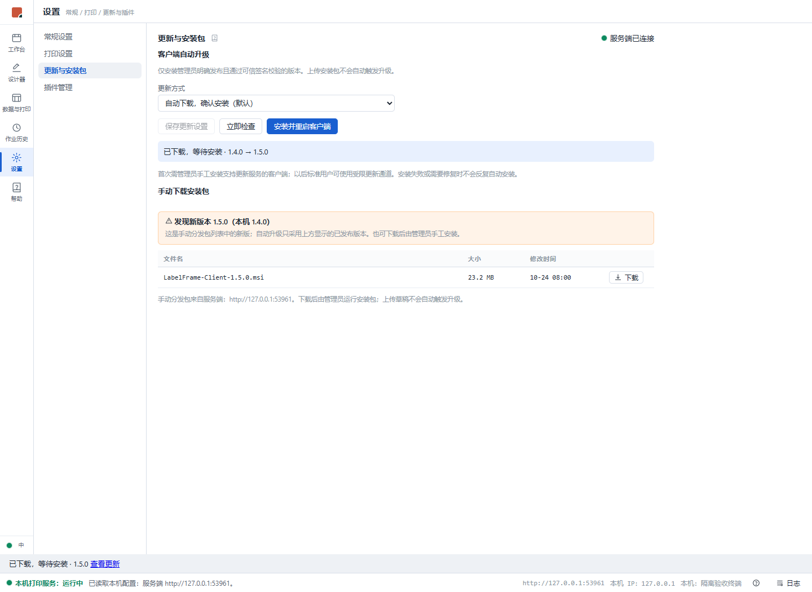
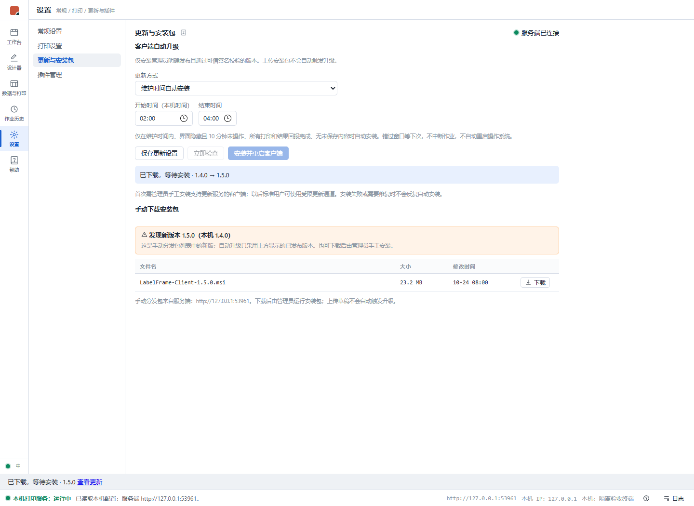
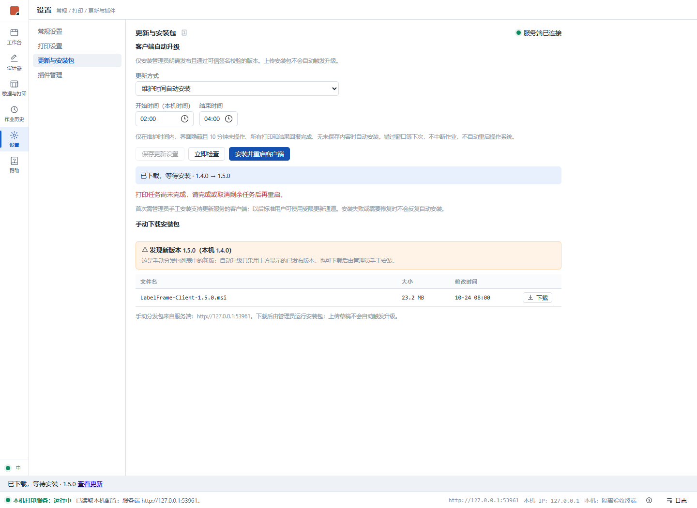
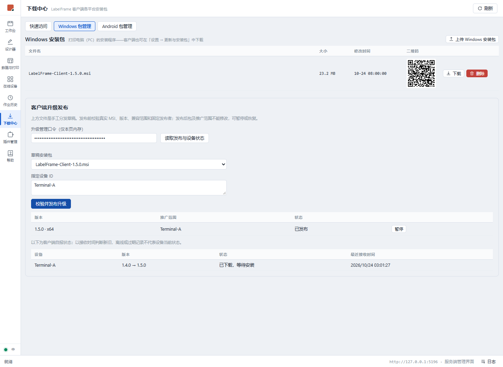
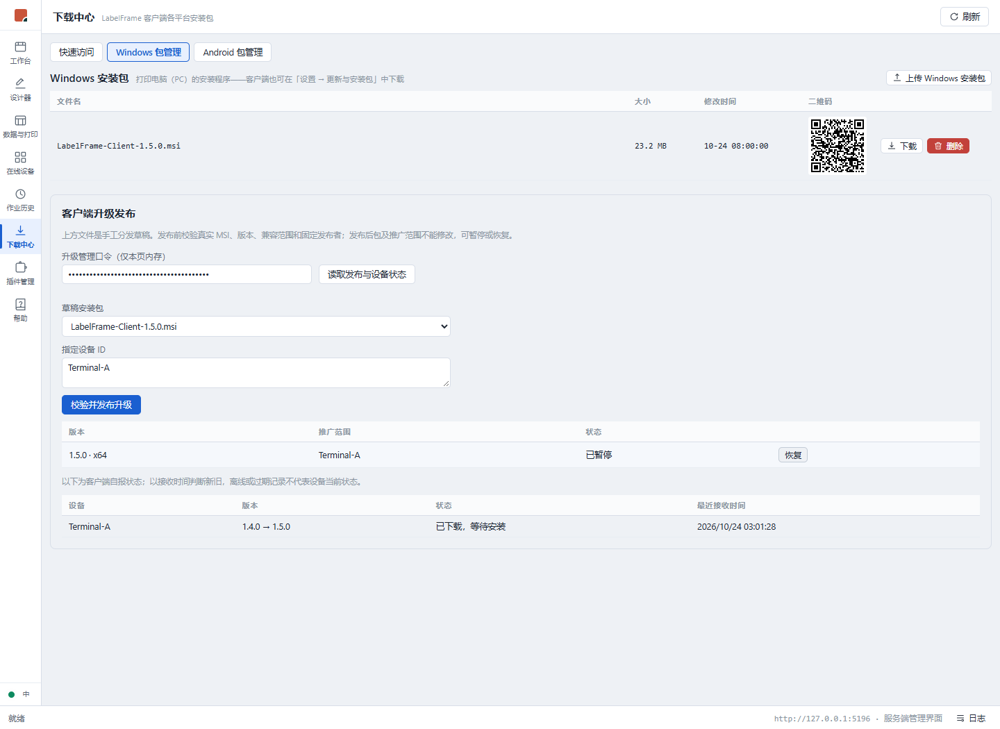

# Windows 客户端受控升级验收证据

日期：2026-10-24。任务：[迭代 165 #452](https://github.com/marci-labs/LabelFrame/issues/452)。设计与信任边界见 [client-updates.md](../../design/client-updates.md)。

## 本地通过

- Windows Release 全量构建：0 警告、0 错误；排除 Perf/Soak 的 .NET 测试 1,281 项通过。
- Node 26.12.1 / pnpm 12.15.0：client 与 server 模式各 765 项测试通过，双构建通过；lint 0 错误，51 条既有警告。
- 构建实际 Client MSI（仅测试，未安装、未发布），现有向导、运行时及退出协调断言通过；新增断言确认升级服务使用 WinHost 同一组件、LocalSystem 独立进程、自动启动、停止/卸载/等待行为、兼容属性和发布者证书打包。
- 真实 Edge 加载两种构建产物，API 使用隔离夹具：默认下载后确认安装、维护时间设置、未保存设置上报、未完成打印的拒绝原因、指定设备发布、暂停与恢复入口、管理口令仅进入请求头；无页面异常。见 [browser.json](browser.json)。此项验证界面行为，不表示真实执行了 MSI。
- 服务端自动回归：不可变发布快照、上传草稿被覆盖后发布包保持不变、同版拒绝、暂停/设备范围同时限制查询和下载、服务端兼容范围、管理令牌/HTTPS/来源验证；发布目录故障后释放互斥，修复存储后无须重启即可重新发布。
- 客户端自动回归：三档策略及跨午夜维护窗口、界面隐藏/空闲要求、请求帧限长及截断、签名发布者/用途/有效期/篡改拒绝、产品族/架构/版本/兼容属性拒绝、不可信安装目录拒绝、安全重启与未回报结果保护、恢复中冻结及失败时重启不解开打印门闩、官方插件按真实版本比较而非文件名字典序更新。
- 真实 Windows 子进程验证：安装监督器未取得提交文件时返回 1602，原父进程仍存活，未调用 msiexec；原用户等待器确认就绪后等待精确父进程退出，再以同一用户拉起无副作用的测试子进程。测试不启动打印宿主。
- 初次 CI 覆盖率运行暴露 PowerShell 冷启动超过 8 秒的就绪超时；已将真实就绪等待上限调整为 60 秒并区分提前退出/超时，原用户等待器须仍存活并给父进程 3 分钟完成准备。测试父进程使用释放屏障，实测子进程完全退出后才清理其工作目录。覆盖率验证仍要求真实就绪文件和原用户/父进程退出断言，不跳过测试。
- 本地完整覆盖率运行 1,281 项通过；将真实 MSI/监督子进程用例与其他宿主用例串行隔离后，宿主全部 520 项覆盖率回归通过，保持既有打印日志测试的产品断言。

## 实际签名与跨平台检查

1. 下载现有 1.4.0 Release MSI，生产检查器验证固定发布者 CMS 和 MSI SIP 实际内容摘要后，因缺少新增兼容属性而拒绝进入自动升级。没有把操作系统对私有自签名证书的链错误直接视为可信。
2. 修改该 MSI 的实际 Property 表后，生产检查器拒绝内容摘要。公有发布者证书 SHA256：`F72D57B22324006D14A83676DA7A0117BB0ACF4D747B73DFCE84E0CB90F1BAA7`。
3. 对无安装行为的 32 KiB MSI 夹具，以临时内存密钥签名；Windows 和 Linux Docker 内的生产检查器均接受完整元数据，得到相同 SHA256 `ED2F2933D71D6069FCC6C997A698D1D6BFC241B213EDEFE38643C745827FDC60`。Linux 使用实际 msitools/osslsigncode，修改后同样拒绝。临时测试证书只用于该隔离探针，没有加入产品信任或系统证书库；未使用产品私钥。
4. 仓库测试保留无签名无副作用夹具，每次测试临时签名，覆盖 Windows 生产检查器的成功、错误发布者及真实表篡改路径。见 [夹具说明](../../../test/LabelFrame.WinHost.Tests/Fixtures/Updates/README.md)。

## 界面记录

## 待验收与恢复条件

2026-10-24 追加：[隔离 Windows 复验与安装器修复](windows-vm.md)。权限已恢复，首装、标准用户真实 MSI 安装及原用户健康恢复已执行；下列内容保留为首轮交付时的欠账记录，当前结果以追加记录和 Issue 最新评论为准。

当前会话没有启动隔离 Hyper-V Windows 虚拟机所需权限；已安装的真实客户端未停止、未覆盖，未在本机安装测试 MSI。以下不以单元测试或模拟 API 冒充实测，Issue 保持开放并标记 `待验收`：

1. 管理员首次安装含升级服务的正式候选 MSI，验证 Program Files ACL、SCM 服务和标准用户命名管道访问；再用同一正式发布者签名的更高版本测试后台发现、下载和维护安装，无 UAC 弹窗、无 OS 自动重启。
2. 完整 WebView2/托盘退出与原用户恢复，核对实际 MSI/运行版本、本地 API、真实插件、设备路由注册、配置/数据库保留；断网、安装失败、MSI 正被占用、恢复超时、断电及再次启动场景。
3. 同机 Server 保持运行，兼容范围之外拒绝发布；缺失运行时的实际 MSI 拒绝与旧版恢复；官方插件随包更新和第三方插件实际不被覆盖。
4. 实际打印批次、暂停任务、未保存编辑、回报断网期间都延期；结果回报完成且维护窗口内才允许安装；校验不会重打、漏打或误用模拟打印。

恢复条件：提供可管理的隔离 Windows VM 或独立测试终端、两份正式候选签名安装包和测试打印机/插件，按 #452 AC-01 至 AC-10 串行复验。当前实现未推发版 tag，真实签名安装与发布仍沿标准发版流程进行。
