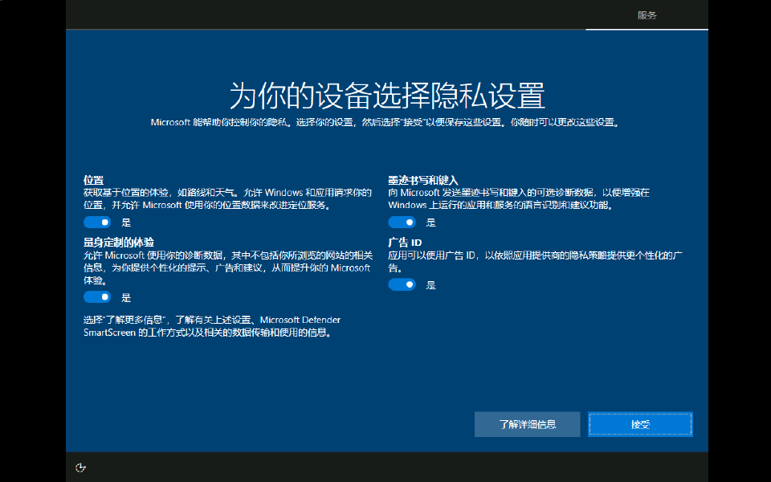

# 隔离 Windows 安装与恢复复验

日期：2026-10-24。关联 #451、#452；基线代码 `242da245`，安装器角色选择修复随本次 PR 提交。

## 环境与信任边界

- 按 clean-win-vm 技能，测试前还原 `LF-Accept-Win10` 的 `baseline-clean-winrm`，通过 PowerShell Direct 管理；只在虚拟机安装运行时和候选 MSI。
- 候选版本 1.4.1 / 1.4.2 / 1.4.3 的 MSI 版本与实际 HostOptions.ProductVersion 一致；版本和临时公有证书替换只用于本地测试构建，构建后恢复源码，未推 tag、未上传安装包。
- 使用临时内存 RSA 测试签名；独立测试阶段由管理员设置相应的测试公有证书，生产检查器仍执行实际 CMS/SIP、产品族、版本、摘要与权限验证。未读取正式发布者私钥，未改正式信任证书或系统根证书。此证据不等于正式发布签名包验收。
- `LFOperator` 仅属于 Users，不属于 Administrators。首次安装通过管理员完成；后续客户端运行于该标准用户的交互会话，更新服务为 LocalSystem。

## 已完成结果

| 项目 | 结果与证据 |
|---|---|
| 首装 | MSI 返回 0；服务自动运行，Program Files 客户端目录所有者 SYSTEM，Users 只有读取/执行权限。 |
| 同用户重启 | 原用户旧 PID 退出，新实例标识改变；未保存会话请求返回 409，清除活动后可以重启。 |
| 插件生效 | 标准用户安装真实 TSPL 0.9.0 后 restartRequired=true、loaded=false；实际重启后标记清除，loaded=true、loadError=null。 |
| 安装失败恢复 | 原 MSI 按名称误选同名更新服务，ShutdownWinHost 返回 1722，安装返回 1603。恢复进程以原用户启动 1.4.1，健康检查后显示 failed，未误报成功。 |
| 修复回归 | 安装器排除 `--update-service` / `--restart-wait`。对真实 MSI 经过 Windows Installer FormatRecord 后的脚本执行角色选择用例：服务+等待器+客户端、只有辅助进程、只有客户端均通过，见 [结构断言](msi-role-verification.txt)。 |
| 标准用户安装 | 修复后 1.4.1 → 1.4.2 MSI 返回 0；原用户 LFOperator、原会话 1 拉起；实际运行版本 1.4.2，状态 completed，真实 API/插件/连接/路由恢复检查通过，见 [状态及身份](standard-user-upgrade.json)、[保护目录安装结果](standard-user-result.json)。无需用户处理 UAC；安装参数禁止系统重启。 |
| 后台发现与维护延期 | 不调用检查接口，发布 1.4.3 后后台发现并校验下载；维护策略显式开启为 00:00–23:59，隐藏启动尚未空闲 10 分钟时 deferred，见 [延期及插件快照](maintenance-deferred.json)。 |

## 正在复验与剩余边界

维护时段自动安装正在等待真实 10 分钟无人操作条件，不修改时钟或空闲阈值。候选 1.4.3 随包包含官方 TSPL 0.10.0，升级前已安装并加载 0.9.0；另存了模板，用于检查插件更新和数据库保留。

真实托盘菜单点击、物理打印机出纸/扫描与断网回报组合、正式签名发布、断电及运行时破坏矩阵仍未完成，不将本机 API 或 Log 模拟结果计作这些场景通过。Windows 界面捕获工具两次超时，停止该通道；截图由 Hyper-V 只读缩略图 API 获取。

本地 Release 全量构建 0 警告 0 错误，排除 Perf/Soak 的 .NET 1,281 项通过。本次无前端源码变化；前端及三项必需门禁由本 PR 的最新 CI 复验。
