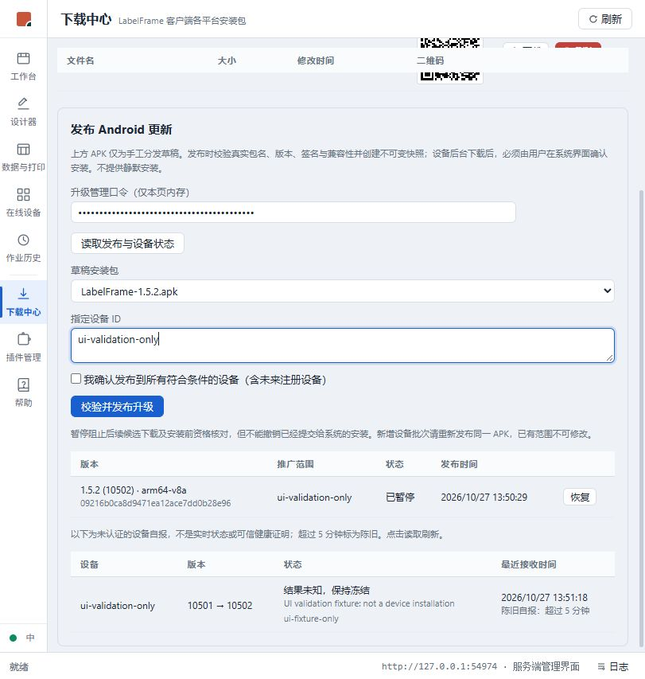
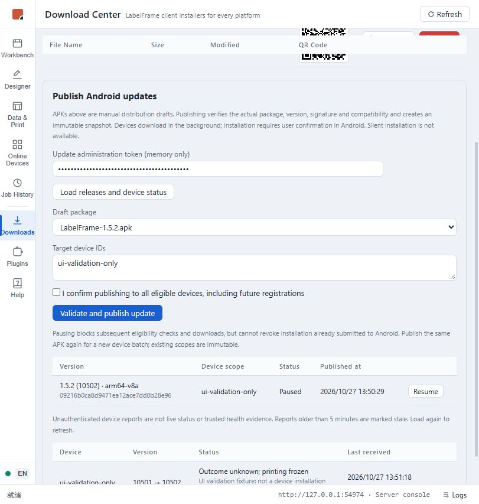

# Android 发布管理页隔离验证

2026-10-27，任务 [#474](https://github.com/marci-labs/LabelFrame/issues/474)。本页仅证明 Web 管理页及真实 Server 发布链，不是 DT50、安装或恢复验收。

## 环境与实际结果

- 当前独立 worktree 构建的 Server 与 `web/dist-server`，只监听 `127.0.0.1:54974`；所有数据库、包与快照位于本机临时隔离目录 `LabelFrame-android-ui-474-20261027`。没有使用默认系统数据目录，没有设备连接。
- APK 为上一阶段 Release 非调试产物 1.5.2 / 10502，SHA256 `1D63EF6936F7DC8BEF346E08B6F712AA25D6A619169CB4EAFDAD21D4A6B69C1A`；签名为本机 Android Debug 证书，不是正式发行签名。服务端配置官方 apksigner.jar/aapt2 36.0.0、JDK17 与预置测试证书指纹。
- 浏览器从实际 APK 草稿选择发布，仅指定虚构设备 `ui-validation-only`。真实校验成功，快照 ID `09216b0ca8d9471ea12ace7dd0b28e96`；真实版本、ABI 与摘要与本地构建相符。
- 空设备列表的发布按钮禁用；全量未勾选。真实暂停与恢复均成功，结束时再次暂停，隔离服务已停止。
- 错误管理口令返回权限不足，不开放发布表单；刷新页面后口令清空。
- 中英 UI 走查：发布策略、范围、暂停边界、版本与时间、事务号、未知冻结状态均可读。真实等待超过五分钟后出现陈旧自报提示。
- 状态行由 HTTP 手工注入，原因明确为 `UI validation fixture: not a device installation`，事务 `ui-fixture-only`；不是设备真实回报，不能计作健康恢复或安装结果证据。

## 本阶段自动化回归

- 前端双模式各 66 文件 / 776 测试通过，含新增六项 Android 发布组件测试：APK 过滤、显式范围、全量确认、去重、仅确认策略、口令内存、权限拒绝、暂停恢复、取消旧请求/离页、不重复提交、失败后先刷新、英文自报与陈旧提示。
- `pnpm lint` 退出 0；新组件零告警，既有模块 React 告警保持，不称全仓零警告。
- `pnpm build` / `pnpm build:server` 通过；保留既有大 chunk 提示。
- `dotnet build LabelFrame.slnx --no-restore`：0 警告 / 0 错误。
- `dotnet test LabelFrame.slnx --no-build --filter "FullyQualifiedName!~Perf&FullyQualifiedName!~Soak"`：1571 通过、1 显式外部 APK 测试跳过。Core329 / Api36 / Android100 / Client3 / Bootstrapper282 / Server221 / WinHost600。

## 仍未验收

DT50 正式备份/签名复核、ART 验签、系统确认/取消/后台/进程重建、更新后健康与业务负向均未在本阶段操作。未知路由恢复仍阻断：一次「服务端无 Claimed」查询不能排除迟到领取请求，不能据此直接清除日志；需要先建立可靠的核对边界。详见 [设计](../../design/android-updates.md) 与 Issue 后续证据。
