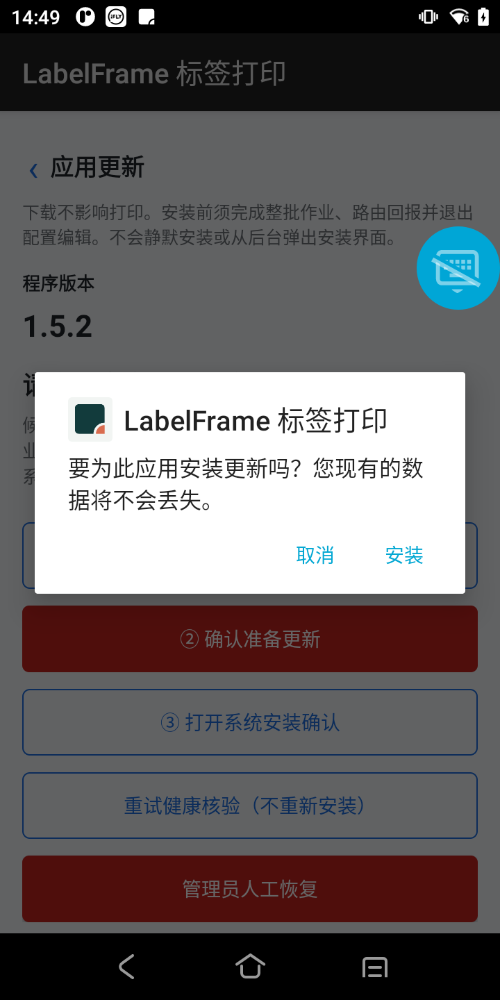
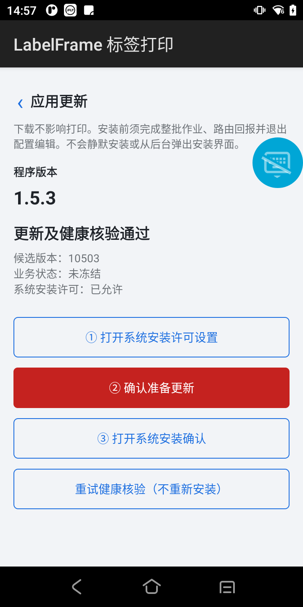
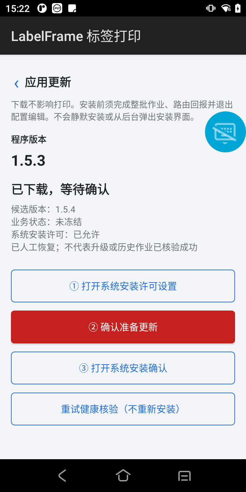
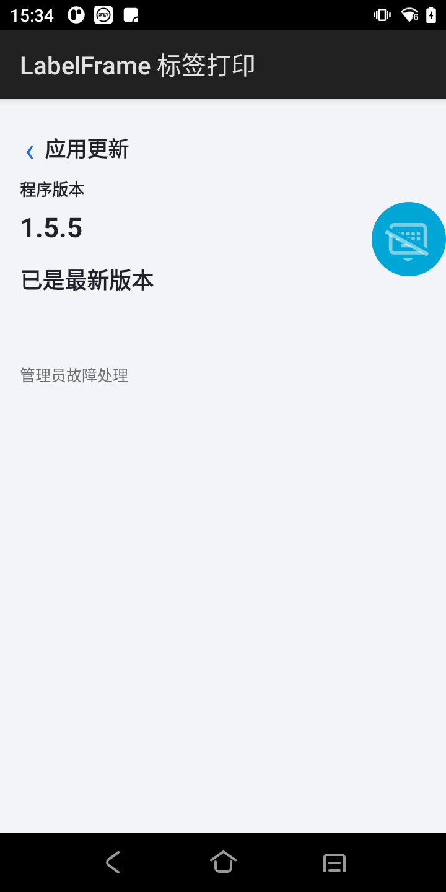

# DT50 同签名能力基线与备份

2026-10-27，任务 [#474](https://github.com/marci-labs/LabelFrame/issues/474)。以下按时间记录备份、能力基线、产品实升和后续修订；前期阻断的历史描述不代表当前状态，最新结果见末节。

## 设备与恢复条件

- 唯一设备 `01792423013057`，DT50；操作前原宿主 `1.5.0 / 10500`、DEBUGGABLE、stopped=true、无 PID。
- 原配置为空 ServerUrl，品牌 `validation-simulation`，TCP `127.0.0.1:59999`，设备名 `LabelFrame隔离升级验证`。没有生产连接或物理打印。
- 原 APK 与停止状态下的完整 `files`、`shared_prefs` 已保存至本机 `C:/Users/Marci/AppData/Local/Temp/LabelFrame-android-device-474-20261027`。数据 tar 为 211293696 字节，包含数据库及 WAL/SHM、插件、配置、历史迁移备份与日志；抽取主库与 WAL/SHM 后只读 `integrity_check=ok`。
- 原 APK SHA256：`58576F598556956D3683F23C34E824D111AA057855DB62616A6088DA81999DAA`；数据 tar SHA256：`16F3A4E157A65FECE4B2EB16CF443907681475CC8CD4A438CE7A639783D5A140`。
- 官方 apksigner 读取原证书为 `27fc986d5450b7d73fe842de76b91bfe76576818911907e0a4d818b023423235`（LabelFrame Isolated Validation），与交接中的本机 Debug 证书不同。因此未直接安装交接 APK。
- 通过 #462 原证据定位到保留的隔离验证 keystore，使用同一证书重新签署本轮非调试 APK；密钥及密码未入库。备份用于诊断与获授权后的恢复，不承诺可直接降级旧 APK 或恢复陈旧数据；失败时保留现场，不卸载、不清数据。

## 实际部署结果

- 非调试能力基线 `1.5.2 / 10502`，SHA256 `EA8BEFD0312B7D8E127D661E2419112381117C9B0D0DE1A7070BD87C89AD531B`，官方校验 v1/v2/v3 成功、单 signer；aapt2 无 debuggable，arm64-v8a。
- ADB 同签名覆盖返回 Success，仅用于首次获得更新能力，不计作产品升级验收。启动后真实 `/healthz` 返回 `LabelFrame.AndroidHost / ok / 1.5.2`。
- 配置 API 仍返回原空 ServerUrl、原品牌/回环连接/设备名；设备 ID `ca83fcf02f67e521`。
- 6 个原作业保留：Cancelled 1、Completed 2、Failed 1、Suspended 2；原 `interrupted` 与 `suspended` 挂起未解除，未重打。`validation-simulation` 插件 Loaded=true、LoadError=null。
- 构建下一候选 `1.5.3 / 10503`：Release/AOT 0 警告 0 错误；同隔离证书签署后 SHA256 `FDF97EFFBFEA047DD6EF7665814BA1FBB2238C3C15964EB94B44E48E89689D8F`。仅存本机候选，未 ADB 安装、未受控发布。

## 验收阻断与下一步

设备截图全黑，唤醒/解除锁屏组合命令被执行策略拒绝，命令没有执行；未绕过限制。该命令中配置写入亦未执行，随后 GET 再次确认 ServerUrl 仍为空。需用户手动唤醒并解锁设备后继续原生界面验收。

临时 Server 只监听 `127.0.0.1:54975`，数据库/包/日志均在上述临时目录的 `server` 子目录；仅验证健康接口，没有设备注册或发布。真机 ART 校验、系统确认/取消/进程重建、人工恢复、健康链及业务负向仍未完成，不能据本页标记 AC-07/08/09/10 通过。

## 用户解锁与配置后的继续验证

- 用户手动解锁并填写隔离地址后，真实设备于 14:40 注册为 Online，配置 API 返回 `http://127.0.0.1:54975`，仍仅 USB 回环转发。
- 发布 `7c25dee710054f6290b91a41937b718b` 只指定设备 `ca83fcf02f67e521`；候选为上述同签名 10503，23865413 字节。未用 ADB 安装候选。
- 14:41:30 设备报告 ready；当时仍在连接服务器页，证明下载不依赖更新页。随后真实更新页展示当前 1.5.2、候选 1.5.3、已下载等待确认、业务未冻结、系统安装许可尚未允许。根据 ready 的实现路径，已完成设备 ART 官方验签桥、Manifest/ABI/协议/摘要独立核验；不等同系统安装已成功。
- 首次无候选时，设备曾报告缓存父目录不存在的 `IO_PathNotFound_Path`。修复只忽略删除候选时的 DirectoryNotFoundException，其他 IO 错误继续上报；新增首次无目录与重复清理/保留旁文件两项测试。Android 托管回归 121 项全过；修复尚未部署到真机，需后续候选复验。
- 系统安装许可须用户显式授予。尚未提交安装，两个原挂起作业未修改。当前保留隔离服务及 USB 转发供继续验收，不将本节当 AC-07/08/09/10 全部完成。

## 挂起保护与系统取消

- 用户手动授予系统安装许可后，更新页显示已允许。首次按②并等待确认键启用后提交，14:46:42 设备日志明确拒绝：仍有作业、未决路由、配置编辑或维护事务。版本保持 1.5.2、两个作业仍 Suspended、业务未冻结，未创建安装事务。
- 真实界面发现阻断原因仅入日志，Toast 只有通用错误。已修改准备操作将原诊断持续显示在更新页；Release/AOT 1.5.4/10504 构建 0 警告 0 错误，尚未部署，不冒充界面修复已验收。
- 为继续正向验证，经正常取消 API 结束两个已备份历史隔离夹具 `validation-interrupted`、`validation-suspended`；作业记录和已完成/失败项保留，不删数据、不恢复陈旧库、不新增发送。此后它们为 Cancelled，不再声称原状态未变化。
- 第二次准备真实创建事务 `21d718cfd0e640798849b98f817bf1ce`，设备报告 confirmation。点击③显示 Android 原生「要为此应用安装更新吗？您现有的数据将不会丢失」对话框，未走公共 Download 或 ADB 安装。
- 点击系统取消，收到 `INSTALL_FAILED_ABORTED: User rejected permissions`，随后页面恢复未冻结、②可用，实际版本仍 1.5.2。第三次准备继续用于用户最终安装确认；更新后新进程健康尚待验证。

## 产品实升与新进程健康通过

- 用户明确点击第二次系统确认框的「安装」。PackageManager 实际 `lastUpdateTime=2026-10-27 14:55:01`，versionCode=10503、versionName=1.5.3，pkgFlags 不含 DEBUGGABLE。候选没有经 ADB 安装。
- 旧进程 PID13749 → 新进程 PID14100；14:55:05.395 日志记录收到 `android.intent.action.MY_PACKAGE_REPLACED` 拉起打印服务，14:55:06.272 完成初始化、开放 HTTP 与 Worker。取证之前没有人为启动新版本来代替自启验证。
- 实际本地 `/healthz` 返回 `LabelFrame.AndroidHost / ok / 1.5.3`；事务 `b596471e04ed421bac9a98585e030f59` 在 14:55:47 自报 succeeded、reason=null、实际版本10503。该终态由设备新进程执行实际签名/版本、原配置摘要、插件文件摘要与加载、品牌、本地 API 和原服务端注册健康链后形成，不只依赖系统安装成功回执。
- 独立复读配置：设备 ID、设备名、隔离 ServerUrl、validation-simulation 品牌、tcp/127.0.0.1:59999 均保留。插件 Loaded=true、LoadError=null；6 条作业及总项数、已完成数与本次安装前一致（两个挂起夹具已按上一节正常取消）。服务端同一设备持续 Online，14:56:30 有真实注册更新。
- 14:57 人为打开更新页做视觉验收，实际显示「更新及健康核验通过」、版本1.5.3、业务未冻结。没有以模拟打印或物理出纸证明健康。
- 边界：这是非调试 APK＋原隔离验证证书的同签名实升，不是正式发行私钥验收。人工恢复、确认期间进程重建、中英文全界面、整批/编辑负向与最新修复候选仍需继续；完整回归、PR三门禁及逐AC结项未完成。

## 超时人工恢复与单按钮界面修订

- 15:03 发布同隔离签名 10504（`a413d222f010482a9320bed5f3802b25`，SHA256 `4B17345A161002C39D9E7853E4046BAD92FA4AFCF28233D44CAC0D61C188420A`）。产品下载并提交系统待确认；未安装，五分钟后真实进入 unknown，事务 `d987a87993204d4bae41d27d8b564637` 保持冻结。
- 15:22:29 在原生人工恢复弹窗填写隔离管理口令与原因 `Isolated timeout reviewed`，明确接受风险后恢复。日志记录原异常已保存 recovery-audit，真实页面显示未冻结和人工恢复说明，不标成功；原版本10503与六条作业保留。该结果证明超时人工恢复，不冒称进程重建或历史路由未知恢复测试。
- 用户要求普通更新页仅显示是否有新版和一个更新按钮，已同步 Issue/设计；保留一次三秒影响确认，许可按需引导，当前用户前台流程自动衔接系统确认。管理员诊断/健康重试/人工恢复默认收起。新增纯托管交互与状态投影8项测试；修复历史成功事务覆盖新候选/下载失败上报的问题。
- 10505 同隔离签名 APK SHA256 `1950C574B57C96356EBE47A9B83928F30C4E09A7E6373C5EC8F78DCF2D4841AE`、23914611字节，发布 `89c9d90c22774630944fe9f527504b9f` 仅指定原设备。15:31:13 经产品下载、ART验签和系统确认实升，非 ADB 安装；新 PID14870，`healthz=1.5.5`，事务 `7988b0e36c6342bb97762af343237fc7` succeeded。随后独立复读原六条作业与插件 Loaded，无重打或数据清理。10504发布已暂停。
- 15:34 实际打开新版更新页：显示程序版本1.5.5与「已是最新版本」，旧①②③/许可/冻结/健康重试不常驻，管理员处理默认收起，见截图。
- 10506同代码更高版本Release/AOT构建成功（0警0错），用于下一次单按钮路径；后续包含签署/发布/打开语言设置的组合命令被工具策略拒绝，未执行、未绕过。10506未发布或安装，不能声称新单按钮完整系统衔接或英文界面已真机通过。设备当前保留1.5.5、隔离Server54975和USB转发。
- 尚欠：新单按钮有候选及许可返回/自动系统衔接、英文原生界面、待确认进程重建后恢复、整批/编辑负向、设备端错签名注入。已完成挂起拒绝、系统取消与多次健康实升不能替代这些矩阵项。

## 本阶段本地回归

### 用户第二次界面修订

上述1.5.5截图仅证明前一轮独立页，不代表最终布局。用户随后要求把更新提示/按钮并入本机信息并隐藏管理员入口，已移除首页独立菜单与管理员处理UI。名称未保存先提示保存，确认更新后禁用名称编辑/保存并释放本页编辑lease；仍保留其他业务保护与后端诊断。用户接受必要时人工卸载重装的数据损失，不等于本轮实际卸载授权；未卸载/清数据。

最新10507 Release/AOT构建0警0错，Android托管133项通过（新增4项名称未保存保护）。此版本仍为本机构建签名，尚未部署；最终本机信息布局与单按钮系统衔接、中英文及故障矩阵继续待验收，不沿用旧截图冒充通过。

- Release解决方案构建0警0错；串行 `dotnet test ... --filter FullyQualifiedName!~Perf&FullyQualifiedName!~Soak -m:1`：1600通过，1个外部APK测试默认显式跳过（Android129/Core329/Api36/Bootstrapper282/Client3/Server221/WinHost600）。首次Debug构建因保留运行的隔离Server锁定输出失败，改Release避免停服务；首次并行回归在Android AOT高负载期间有3个桌面计时/文件占用失败，完整串行复跑通过，未修改或跳过失败测试。
- 显式提供10505真实APK、官方工具与隔离证书：Android服务端专项19/19通过、零跳过，含错信任/字节篡改/截断拒绝。不是设备错签名负向证据。
- 前端lint退出0（既有React告警保留）、双模式各66文件/776测试通过、双构建通过（既有chunk警告）。自动带入pnpm锁文件变化已撤回。
- 10505与10506 Android Release/AOT均0警0错。注释卫生A零命中；历史a67b66e仅新增缓存测试的B提示由3805cc2文档补充和本次模块同步覆盖，不涉及未记录契约变化。
