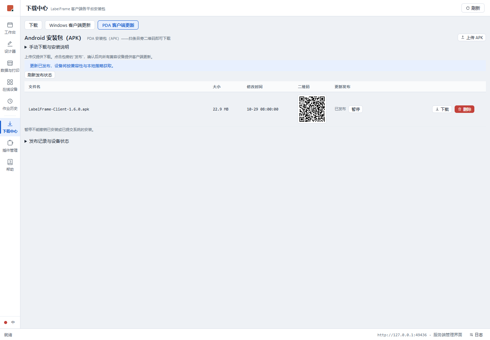
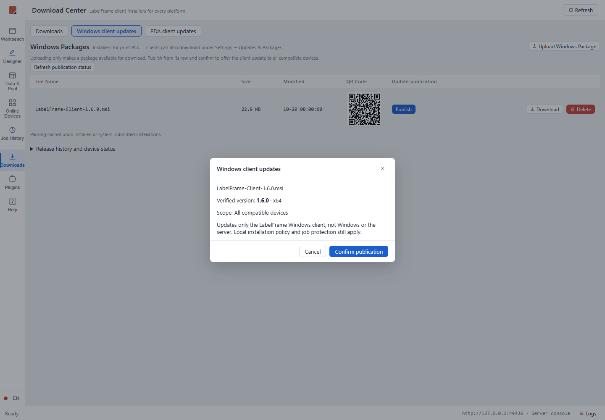

# 安装包发布管理验证

任务：[#476](https://github.com/marci-labs/LabelFrame/issues/476)。2026-10-29 独立工作树验证；未操作设备、生产或原演示服务。

## 真实浏览器界面

运行 `cd web; node scripts/verify-update-publishing.mjs`，使用当前服务端生产构建和无头 Edge。脚本启动随机回环端口静态服务器，接口由 Playwright 模拟；不是正式签名包实升或真实设备证据。两平台 × 中英文均完成：列表发布 → 真实元数据形状预览 → 单一确认 → 已发布 → 暂停；断言无 Authorization、空设备数组、确认摘要，确认前不提交，普通下载页可访问。浏览器与临时服务器退出，无常驻进程。

## 后端与回归边界

- `UpdatePublishingTests` 覆盖两平台预览不发布、确认摘要与替换后字节不同则拒绝、失败快照清理；使用可控检验器，不冒称真实签名验证。
- `AndroidUpdatesApiTests` 覆盖真实内存 HTTP 管道的匿名 HTTP 管理、跨源拒绝、旧凭据恢复请求拒绝、真实返回元数据形状、摘要拒绝和发布/下载/暂停资格。
- 已有产品包检验器与设备安装链不修改；外部 APK 验签用例缺少输入时明确跳过。完整 build/test、前端双模式/双构建、lint 与 CI 结果以 Issue / PR 最新记录为准。
- 一次全量运行的既有 Windows 等待器测试失败，单独重跑通过；未修改测试或延长超时以掩盖，完整重跑结果另记 Issue。

## 权限与操作边界

更新发布不设身份鉴权，部署仅限可信网络；同源校验不能替代 admin/guest 权限。未来统一权限独立迭代，下载页仍须普通用户可访问。人工故障恢复不保留；自动升级后的健康核验继续存在。暂停不撤销系统已接收的安装或已装版本。
